<picture>
  <source media="(prefers-color-scheme: dark)" srcset="assets/header-dark.svg">
  
</picture>

 

I build Salesforce solutions end to end: data models, **Apex**, **Lightning Web Components**, automation, integrations, and AI agents with **Agentforce**. I started out as a React Native trainee, which is why I still enjoy building the front ends that talk to Salesforce.

 

### ⚡ What I work on

<table>
  <tr>
    <td width="50%" valign="top">
      <b>🤖 Agentforce</b> 
      Agent topics and instructions, custom Apex &amp; Flow actions, Prompt Builder, and a WhatsApp service agent with human handoff.
    </td>
    <td width="50%" valign="top">
      <b>🧱 Apex</b> 
      Bulk-safe trigger handlers, batch &amp; queueable jobs, and test classes that cover bulk, positive and negative paths.
    </td>
  </tr>
  <tr>
    <td width="50%" valign="top">
      <b>🧩 Lightning Web Components</b> 
      Record pages, Experience Cloud portals and custom UIs backed by cacheable Apex.
    </td>
    <td width="50%" valign="top">
      <b>🔌 Integrations</b> 
      REST and Apex REST APIs, Named Credentials, OAuth / Auth0 and JWT.
    </td>
  </tr>
  <tr>
    <td width="50%" valign="top">
      <b>⚙️ Automation</b> 
      Record-triggered and screen Flows, multi-step approval processes.
    </td>
    <td width="50%" valign="top">
      <b>⚛️ React</b> 
      Front ends that read and write Salesforce data, such as a careers portal on Apex REST.
    </td>
  </tr>
</table>

 

### 🧰 Stack

 

### 🏅 Credentials

- **Salesforce Certified Agentforce Specialist**
- **Salesforce Certified Platform Developer**
- Trailhead **Expeditioner** · 57K+ points · 91 badges · 11 trails
- **Agentblazer Champion 2026**

 

### 📌 Right now

- 🔭 Designing Agentforce agents and the custom Apex actions behind them
- 🛠️ Rebuilding real-world patterns as public demos (client code stays under NDA)
- ✍️ Writing about Apex, LWC and Agentforce

 

### 📫 Let's connect

Open to Salesforce roles and freelance projects.

 

  Let's build something <i>agentic</i>.

